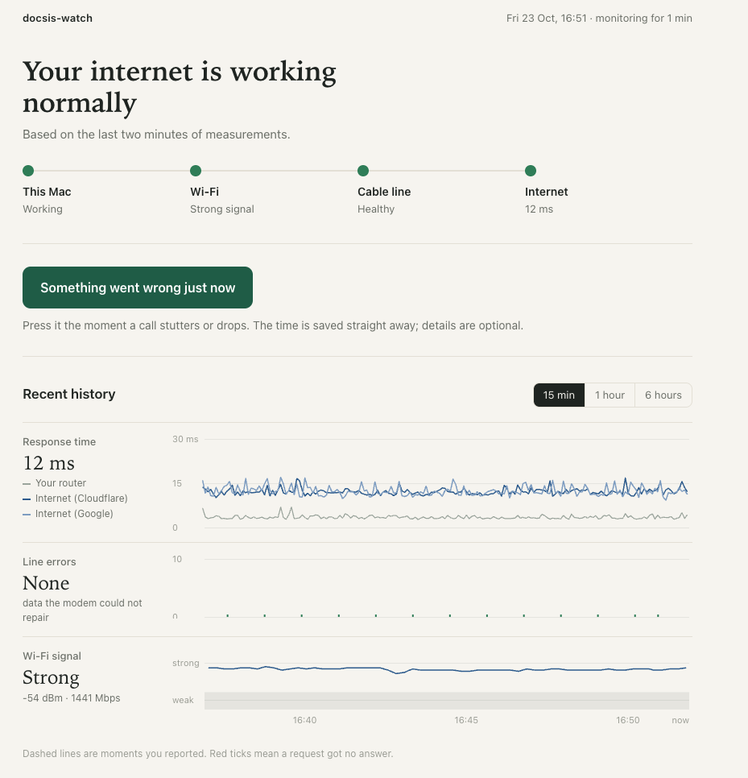
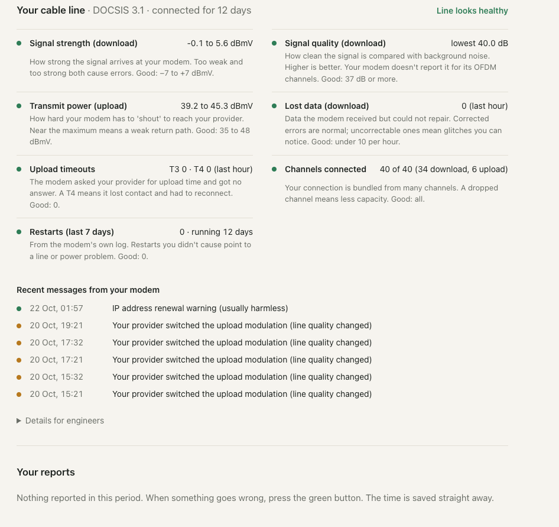

# docsis-watch

**Was that frozen video call your Wi-Fi, or your internet line?**
docsis-watch tells you, in plain words, and gives you the measurements to
prove it to your provider.

<p align="center">
  
</p>

Calls freeze, sound drops out, and the helpdesk asks you to restart your router.
By the time you call them, the problem is gone and nobody can say what it was.

docsis-watch runs quietly on your Mac and checks your connection every second.
When a call goes wrong, you press one button. It lines that exact moment up
with what your Wi-Fi, your cable modem and the wider internet were doing, and
tells you where the problem was.

## What you get

- **One sentence that says how your internet is doing right now**, and a simple
  path (*This Mac → Wi-Fi → Cable line → Internet*) that turns amber or red
  where something is wrong.
- **One button for when it goes wrong.** Press it the moment a call stutters.
  The time is saved instantly; you can add what happened afterwards.
- **A plain answer for every problem you report**: inside your home, outside
  your home, or nothing measurable. With the evidence behind it.
- **A report you can send to your provider**, with the measurements an engineer
  needs, and checked so it contains nothing private.
- **Your cable line in plain language.** The numbers your modem reports, each
  with what it means and what "good" looks like.

<p align="center">
  
</p>

## Is it for me?

It's made for people on **cable internet** who use a **Mac** and have calls
that freeze or drop. Linux works too. Windows isn't supported.

You don't need to install anything: it uses only what macOS already has. It
reads the most detail from **Sagemcom F3896** cable modems. With other modems
it still tells you whether the problem was inside or outside your home; it just
can't show the cable line card.

## Get started (about 5 minutes)

1. **Download it.** Click the green **Code** button on this page, then
   **Download ZIP**. Unzip it and move the `docsis-watch-main` folder to your
   **home folder** (the one with your name). Don't leave it in Downloads,
   Desktop or Documents: macOS doesn't let background apps read those.
   Or, if you use git, from your home folder:
   ```bash
   git clone https://github.com/Schweigmann/docsis-watch
   ```
2. **Start it.** Open the *Terminal* app and run:
   ```bash
   cd ~/docsis-watch-main     # or ~/docsis-watch if you used git
   python3 autostart.py install
   ```
   It starts now and every time you log in, and restarts itself if it ever
   stops. If your Mac asks to install "command line developer tools", click
   *Install*, wait, and run the command again.
3. **Open the dashboard** at **http://127.0.0.1:8787** and bookmark it.

Want to look around first? `python3 docsis_watch.py --demo --open` shows the
dashboard with made-up data.

**Using Claude Code?** Open the folder and say: *"Read SETUP-FOR-CLAUDE.md and
set this up for me."* It checks your Mac and your modem, starts the monitor and
explains the dashboard.

## When a call goes wrong

1. **Press "Something went wrong just now" straight away.** The exact second
   matters more than anything else.
2. Pick what happened (video froze, sound dropped, call dropped…) and press *Save*.
3. Read **What we found**:

| What you see | What it means | What to do |
|---|---|---|
| **The problem was outside your home** | Your own router answered fine, but the internet beyond it didn't. | Contact your provider. Send them the *Summary* from the report. |
| **The problem was inside your home** | Even your own router stopped answering properly. | Move closer to the router, try a network cable, or restart the router. |
| **This Mac was overloaded** | The network was fine; your Mac was too busy. | Close heavy apps during calls. |
| **Nothing we measure changed at that moment** | Your connection looked normal. | The call service itself may have had trouble. Keep reporting: a pattern over several days is still useful. |
| **We can't tell what happened** | Nothing was being measured: the Mac was asleep, or the monitor was off. | Keep the Mac plugged in, with the lid open, during calls that matter. |

## Tips for the best evidence

- **Keep the Mac plugged in, with the lid open.** It stays awake on power, but
  stops measuring when the lid is closed or it sleeps on battery.
- **Report every problem, even small ones.** Three reports with the same answer
  convince a helpdesk far more than one.
- **A network cable gives the clearest picture.** On Wi-Fi, every measurement
  includes your Wi-Fi; the app accounts for that, but a cable removes doubt.
- **Several people on one Mac?** One monitor is enough. Open the same address
  from any user account.

## Your privacy

- **Everything stays on your computer.** Nothing is uploaded. A report only
  leaves when you send it yourself.
- **It never logs in to your modem** and never changes a setting. It only reads
  what the modem shows without a password.
- **No audio, video, screen content or browsing is recorded.** It only measures
  with small test messages it sends itself.
- **Reports are checked before export**: no device serial numbers, hardware
  addresses or other people's IP addresses.

## Questions

**Does it slow down my internet?** No. It sends three tiny test messages a
second and never runs speed tests.

**How do I stop or remove it?** `python3 autostart.py uninstall` stops it and
removes it from login. Your measurements stay in the `data` folder; delete the
folder to remove everything.

**Is it running?** `python3 autostart.py status`, or just open the dashboard.
The bottom of the page says whether all sensors are working.

**Does it work with my modem?** See [Supported modems](#supported-modems). If
yours isn't listed, everything except the cable line card still works.

---

# Technical details

The rest of this page is for the technically curious and for developers.

`python3 -m unittest discover -s tests` runs the 40 tests. `TESTPLAN.md` is a
30-minute first-run walkthrough.

## The dashboard in detail

**The top line** answers "is my internet OK right now?" in one sentence, based
on the last two minutes. Under it, four steps (*This Mac → Wi-Fi → Cable line →
Internet*) turn green, amber or red, so you can see *where* something is wrong.

**"Something went wrong just now"**: press it the moment a call stutters. The
time is saved on the press; what happened, how long and in which app can follow.

**Recent history**: response time (to your own router and to two internet
services), line errors (data the modem could not repair) and Wi-Fi signal, on
one shared timeline (15 min / 1 hour / 6 hours). Dashed lines are your reports;
red ticks are pings that got no answer.

**Your cable line**: the modem's numbers in words. One verdict
(*Line looks healthy* / *keep an eye on …* / *Problem on the line: …*), then:

| Row | What it tells you | Good |
|---|---|---|
| Signal strength (download) | How strong the signal arrives. Too weak *and* too strong cause errors. | −7 to +7 dBmV |
| Signal quality (download) | Signal vs. background noise (SNR/MER). Higher is better. | ≥ 37 dB |
| Transmit power (upload) | How hard the modem must "shout" to reach the provider. | 35 to 48 dBmV |
| Lost data (download) | Uncorrectable errors **added in the last hour**: glitches you notice. | under 10 |
| Upload timeouts | T3 = an upload request went unanswered. T4 = the modem had to reconnect. | 0 |
| Channels connected | The line is a bundle of channels; a dropped one is lost capacity. | all |
| Restarts (last 7 days) | From the modem's own log. | 0 |

Modem counters are totals since its last restart (billions of *corrected*
errors is normal). Only the **increase** matters, which is what the card and the
reports show. Limits are rules of thumb (in line with community-documented
defaults for Sagemcom cable modems), not a provider specification; they live in
`analysis.LIMITS`. The raw channel tables are under *Details for engineers*.

**What we found** (click one of *Your reports*): a plain answer first, then the
evidence. Read *Not measured this time* too: it lists what the analysis could
not see. The technical verdict and confidence are in small print, and the
exports keep that wording because they are meant for the provider's engineers.
Confidence is `high` only when two independent layers agree.

| On screen | Technical verdict | Meaning |
|---|---|---|
| The problem was outside your home | Access line / DOCSIS impairment | Your router stayed clean, the internet beyond it degraded. Worth reporting to your provider. |
| The problem was inside your home | Local: Wi-Fi / LAN / gateway | The path to your own router degraded. Not the provider's line. |
| This Mac was overloaded | The computer, not the network | CPU was saturated. |
| Nothing we measure changed at that moment | Not corroborated | Nothing measured moved. Still a valid observation; it just isn't evidence. |
| We can't tell what happened | No conclusion possible: measurement gap | The Mac was asleep or the monitor wasn't running. |

**Sensors**: the bottom of the page says *All 6 sensors working*. Open it to see
each data source; hover a red one for the reason. The modem only counts as
working when its channel tables are actually being read.

## What it collects

| Layer | Collector | Interval | Source |
|---|---|---|---|
| Active probes | `collectors/ping.py` | 1 s | ICMP to your gateway + 1.1.1.1 + 8.8.8.8 |
| DOCSIS | `collectors/modem.py` | 60 s | the modem's unauthenticated status API |
| Wi-Fi | `collectors/wifi.py` | 15 s | macOS CoreWLAN via `osascript` (no scanning), Linux `iw` (no sudo) |
| Host | `collectors/host.py` | 10 s | load, memory, which interface carries the default route |

Comparing the **gateway** against **off-net** targets is what separates "my
house" from "the line": all traffic crosses the gateway, so gateway clean +
off-net degraded places the fault beyond it. Always keep the gateway as a target.

## Supported modems

| Modem | Status | Notes |
|---|---|---|
| Sagemcom F3896 (DOCSIS 3.1), router mode | ✅ verified on hardware, 2026-10 | Served on the gateway's LAN address over HTTPS, no login. Channels, T3/T4, event log, uptime. |
| Sagemcom F3896 family in bridge mode (`192.168.100.1`) | ⚠️ expected to work, not verified | Same API. |
| Anything else | ❓ unknown | Run `python3 probe_modem.py <modem-ip>` and see `docs/ADDING_A_MODEM.md`. |

Without a readable modem the app still works: probes, Wi-Fi and host give a
fault-domain verdict, and the report says plainly that DOCSIS was unavailable.

## Options

```
--targets 192.168.178.1 1.1.1.1 9.9.9.9   ping targets (always include the gateway)
--modem-hosts https://192.168.178.1       where to look for the modem (default: gateway, then 192.168.100.1)
--modem-interval 60  --wifi-interval 15  --host-interval 10
--db path.sqlite     --port 8787         --host 127.0.0.1
--demo               synthetic data; exports disabled
```

## Safety and privacy, in detail

- **Never authenticates to the modem.** Sagemcom gateways allow one admin
  session whose token does not expire until logout; a collector holding it locks
  you out of your own modem. The data needed is served without login. A
  request-layer guard (`modem.FORBIDDEN`) refuses any login/reboot/reset/set path.
- **Identifiers never reach disk.** MAC, serial and boot file are stripped when
  a response is parsed; SSID/BSSID are hashed with a per-database salt.
- **Exports are checked before they leave.** `bundle.zip` is refused if it
  contains a MAC, serial, token, or a public IP that isn't one of your probe
  targets. Demo mode refuses all exports.
- No audio, video, screen content or traffic is captured. Only ICMP pings it sends itself.

## For developers

```
docsis_watch.py     entry point, arguments, --demo data generator
collectors/         ping · modem (discovery + parsing) · wifi · host — one thread each
store.py            SQLite (WAL). One table per signal, integer UTC ms timestamps
analysis.py         incident windows, fault domain, counter deltas, event log, line health
export.py           summary.md / data.json / bundle.zip + redaction check
server.py           stdlib HTTP: dashboard, JSON API, SSE live feed
static/             vanilla HTML/JS/CSS — no build, no CDN
probe_modem.py      one-shot read-only probe of an unknown modem (saves redacted bodies)
tests/              unittest; tests/fixtures/ holds redacted captures from real hardware
autostart.py        start at login (LaunchAgent / systemd --user), status, uninstall
docs/               ARCHITECTURE.md · ADDING_A_MODEM.md
SETUP-FOR-CLAUDE.md step-by-step setup a Claude Code session can follow
CLAUDE.md           hard-won domain knowledge: modem quirks, macOS Wi-Fi, analysis rules
```

Start with `docs/ARCHITECTURE.md` (how data flows, and the rules that keep
reports honest), then `docs/ADDING_A_MODEM.md` if you have different hardware.

Ground rules for changes:
1. **Unavailable is never zero.** A field the hardware doesn't report is `None`
   and is named in the report's *Not available* list.
2. **Test against captured reality.** Parsers are tested on redacted bodies from
   real devices. Guessed shapes were wrong in four ways on the first real modem.
3. **Stdlib only, no build step.** It must run on a stock machine, offline.
4. **Read-only, unauthenticated.** No adapter may log in or change modem state.

## What it deliberately doesn't do

- **Read WebRTC stats from your call** — another app's connection isn't visible
  to a local page. Teams/Zoom desktop are out of reach.
- **Speed tests** — they cause the congestion they measure.
- **Upload anywhere.**

## Known limits

- Runs on macOS (verified) and Linux (Wi-Fi via `iw`, untested on hardware). No Windows.
- A laptop on Wi-Fi measures the Wi-Fi too. The dashboard says which interface
  you are on; a mesh pod between you and the router is part of "gateway".
- ICMP to a gateway can be deprioritised by the router; that pattern is labelled an artifact.
- One-second probes: a 200 ms microburst is invisible. Modem counters are per minute.
- macOS Wi-Fi has no MCS index (CoreWLAN doesn't expose it), and SSID/BSSID
  stay empty without Location access. Earlier versions polled `system_profiler`,
  which made the Wi-Fi radio scan for ~8 s every poll and added latency spikes
  to calls; it is now only a fallback.

## License

MIT — see `LICENSE`.
